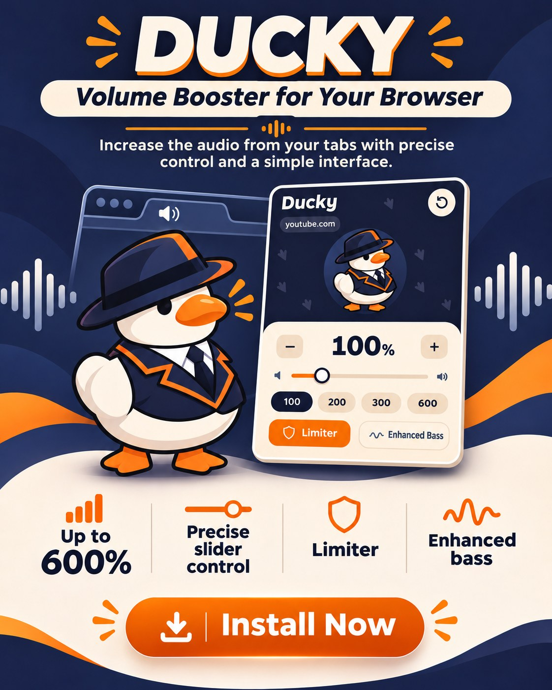
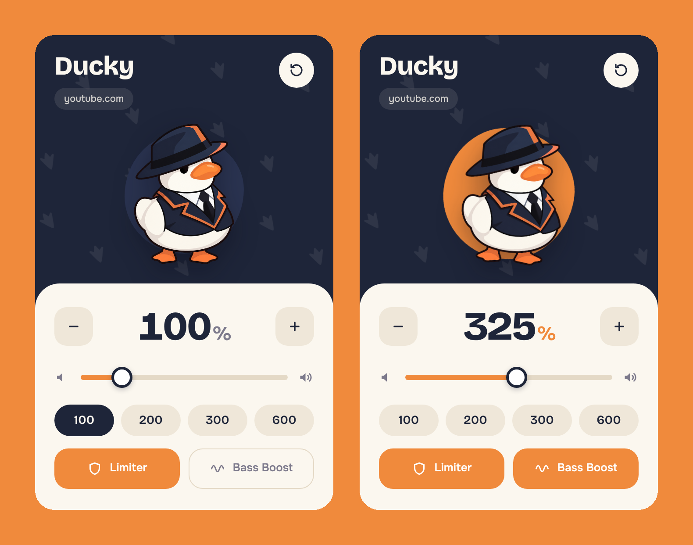

<p align="center">
  
</p>

<h1 align="center">Ducky</h1>

<p align="center">
  <b>Too quiet? Not anymore.</b><br />
  Boost any video, stream or tab up to <b>600%</b> — without the crackle.
</p>

<p align="center">
  <a href="https://github.com/mob949k/ducky/releases/latest/download/ducky.zip"></a>
</p>

<p align="center">
  
  
  
</p>

---

## Why Ducky

Some videos are recorded too low. Some laptops top out too early. Some streams just whisper. Your system volume is at 100% and you still can't hear the dialogue.

Ducky fixes that in one click — and keeps it sounding clean.

| | |
| --- | --- |
| 🔊 **Up to 600%** | Six times louder than the page allows on its own. |
| 🛡️ **Limiter** | Loud is good. Distorted is not. The limiter catches peaks before they crackle. |
| 🎚️ **Precise control** | Slider, ± buttons in 25% steps, or one-tap presets: 100 · 200 · 300 · 600. |
| 🎵 **Bass Boost** | +8 dB on the low end for tiny laptop speakers. |
| 🧠 **Remembers each site** | YouTube at 250%, your podcast site at 150%. Set it once. |
| ⌨️ **Shortcuts** | Change the volume without opening anything. |
| 🪶 **Light** | Does nothing until you boost, ignores muted previews, and sleeps when nothing is playing. |

<p align="center">
  
</p>

## Works where your audio is

YouTube, Twitch, Facebook, online courses, news sites, podcasts, web radio — and the players hiding inside them:

- Players that load **after** you click (embedded video services, lazy players).
- Videos streamed from **another domain or CDN**.
- Players built as **web components** (shadow DOM).
- Sites that play sound through **Web Audio**.

## Install in 60 seconds

1. **[Download ducky.zip](https://github.com/mob949k/ducky/releases/latest/download/ducky.zip)** and unzip it.
2. Open `chrome://extensions` (Edge: `edge://extensions`).
3. Turn on **Developer mode** (top right).
4. Click **Load unpacked** and pick the unzipped `ducky` folder.
5. Pin the duck to your toolbar and reload any tab that's already open.

> Updating? Download the new zip, replace the folder, and click ↻ on Ducky's card in `chrome://extensions`. Your per-site settings are kept.

## How to use

Click the duck in your toolbar:

- Drag the slider (or scroll on it), use **−** / **+**, or tap a preset.
- **Limiter** keeps loud audio clean. It's on by default.
- **Bass Boost** adds weight to small speakers.
- The round button resets to 100%.
- The orange circle behind the duck pulses with the sound — red means it's clipping.

| Action | Shortcut |
| --- | --- |
| Volume up 25% | `Alt` + `Shift` + `↑` |
| Volume down 25% | `Alt` + `Shift` + `↓` |
| Reset to 100% | `Alt` + `Shift` + `0` |

Change them at `chrome://extensions/shortcuts`.

## Private by design

Ducky has **no analytics, no ads, no accounts and no servers**. Your settings never leave your browser. Read the full [privacy policy](PRIVACY.md).

| Permission | Why Ducky needs it |
| --- | --- |
| `storage` | Remember the volume you chose for each site. |
| `activeTab` | Know which site you're on when you open the popup. |
| Access to all sites | Boost audio on any page you visit. |
| `declarativeNetRequestWithHostAccess` | Boost videos served from another domain. Only for the tab and site you're boosting, without cookies, never for your local network, and removed when you leave. |

## FAQ

**Nothing changes when I move the slider.**
Reload the tab. Pages that were open before you installed or updated Ducky need one reload.

**Ducky says "A video from another site can't be boosted."**
That video's server refused cross-site playback, or it needs you to be logged in. It keeps playing at normal volume: Ducky falls back instead of muting it.

**Some streaming services don't get louder.**
Copy-protected (DRM) streams may not let extensions touch their audio. Use your system volume for those.

**There's a short pause the first time I boost some videos.**
Videos from another domain are reloaded once (about half a second) so their audio can be boosted. It only happens once per video.

**Why doesn't it work on `chrome://` pages or the Chrome Web Store?**
Chrome doesn't allow any extension to run there.

**Does it work on Firefox or Safari?**
Not yet. Ducky targets Chrome, Edge and other Chromium browsers (version 119 or newer).

## For developers

```
ducky/
├── extension/            ← the extension (this is what you load in Chrome)
│   ├── manifest.json
│   ├── engine.js         audio engine, runs inside each page and iframe
│   ├── content.js        bridge between the engine and the extension
│   ├── background.js     badge, shortcuts, cross-site permissions
│   ├── popup.html / .css / .js
│   ├── duck.png, icon*.png
│   └── fonts/
├── docs/                 images for this page
├── .github/workflows/    builds ducky.zip for each release
├── CHANGELOG.md
└── PRIVACY.md
```

**Audio chain** (one per frame, idle until you boost):

```
page audio → bass (low-shelf 180 Hz) → gain → limiter → speakers
```

**Run from source:** clone the repo and load the `extension/` folder with **Load unpacked**.

**Publish a release:** bump `version` in `extension/manifest.json`, add a section to `CHANGELOG.md` and push to `main`. GitHub Actions builds `ducky.zip` and publishes release `v<version>` automatically.

## Changelog

See [CHANGELOG.md](CHANGELOG.md).

## Credits

Fonts: [Bricolage Grotesque](https://fonts.google.com/specimen/Bricolage+Grotesque) and [Onest](https://fonts.google.com/specimen/Onest), under the [SIL Open Font License 1.1](https://openfontlicense.org).
